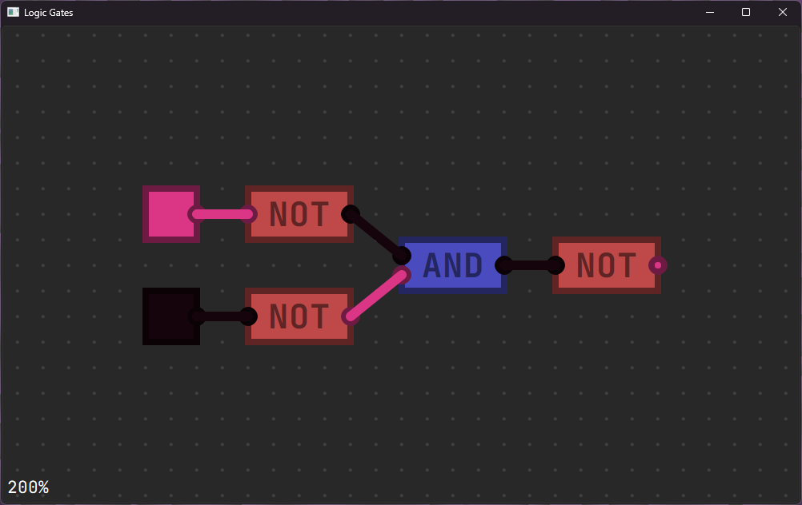

# logic gates simulator
 
(как создать OR)

Соединить контакты/переместить логический элемент/подвинуть вид - ЛКМ 
Переключить переключатель - ПКМ 
Приблизить вид - скролл 
Привязка к сетке - CTRL 
добавить AND - 1 
добавить NOT - 2 
добавить переключатель - 3 
добавить лампочку - 4 

todo: 
изменение конфига и его хранение в базе данных 
создание групп 
сохранение чертежа в файл

Оригинальный проект: https://github.com/SebLague/Digital-Logic-Sim

