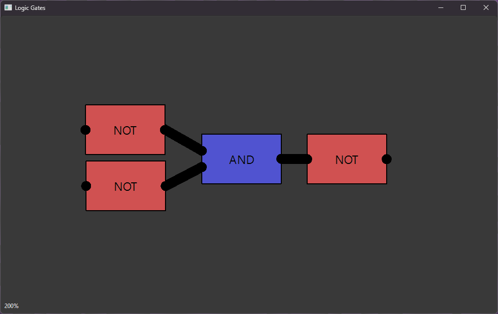

# logic gates simulator
 
(как создать OR)

Пока что можно только создавать цепи из NOT и AND 
Чтобы соединить контакты/переместить логический элемент/подвинуть вид нужно зажать ЛКМ 
Чтобы приблизить вид - скролл 

todo: 
добавить переключатели как источники сигнала 
добавить лампочки/led??? как приемники сигнала 

Оригинальный проект: https://github.com/SebLague/Digital-Logic-Sim

