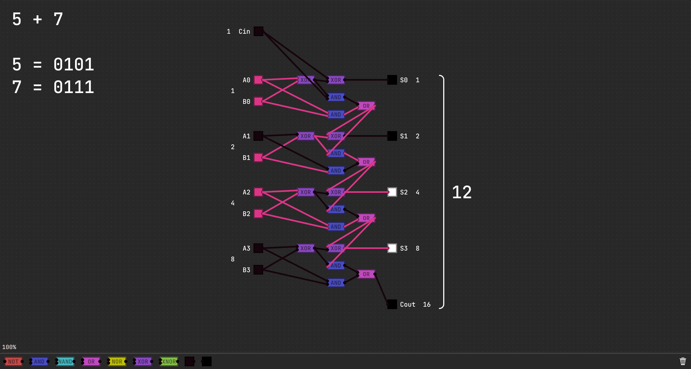

# logic gates simulator
 
(пример схемы 4-х битного полного сумматора (4 bit full adder))

Соединить контакты/переместить логический элемент/подвинуть вид - ЛКМ 
Переключить переключатель - ПКМ 
Приблизить вид - скролл 
Привязка к сетке - CTRL 
Удалить элемент - Backspace 
Выделить область - Shift + зажать ЛКМ

todo: 
изменение конфига и его хранение в базе данных 
создание групп 
сохранение чертежа в файл

Оригинальный проект: https://github.com/SebLague/Digital-Logic-Sim

