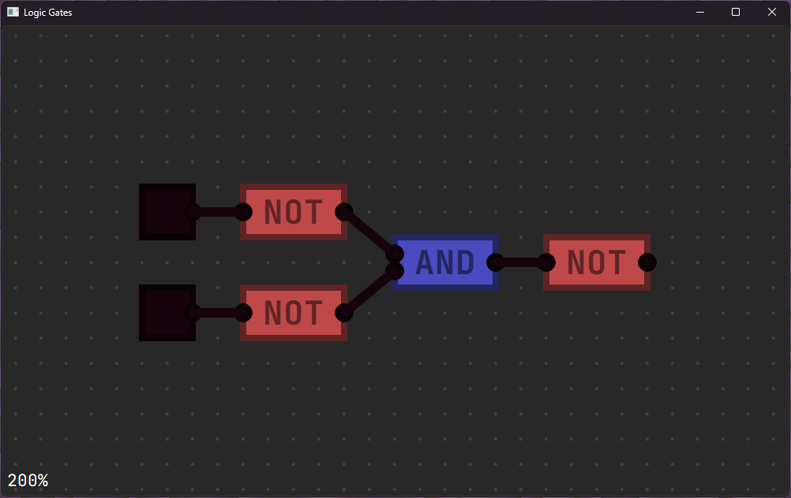

# logic gates simulator
 
(как создать OR)

Пока что передача сигнала не работает 
Соединить контакты/переместить логический элемент/подвинуть вид - ЛКМ 
Переключить переключатель - ПКМ 
Приблизить вид - скролл 
Привязка к сетке - CTRL 
добавить AND - 1 
добавить NOT - 2 

todo: 
добавить лампочки/led??? как приемники сигнала 

Оригинальный проект: https://github.com/SebLague/Digital-Logic-Sim

